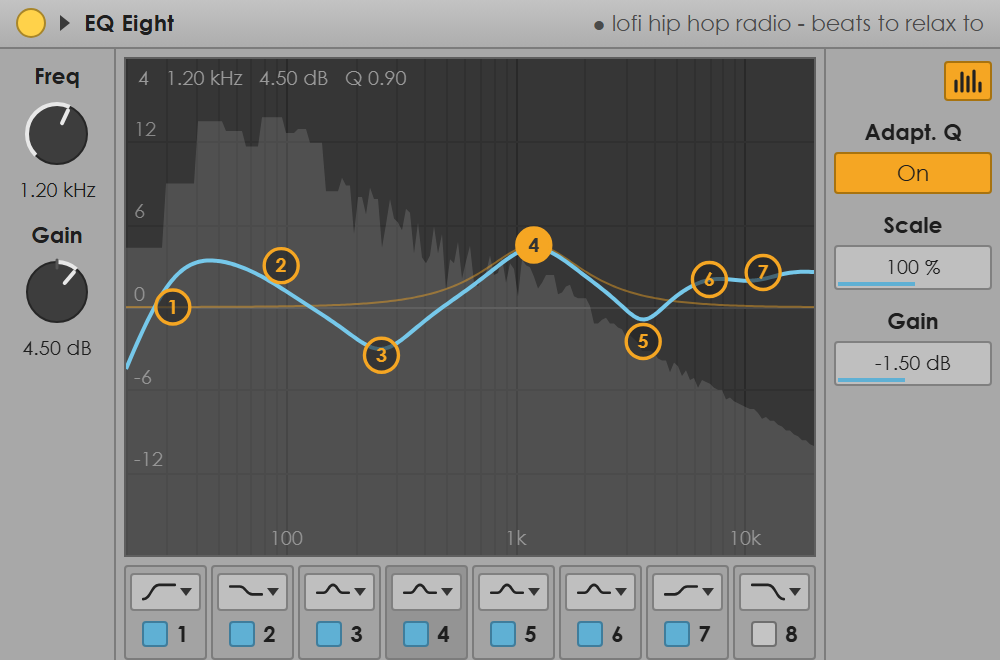
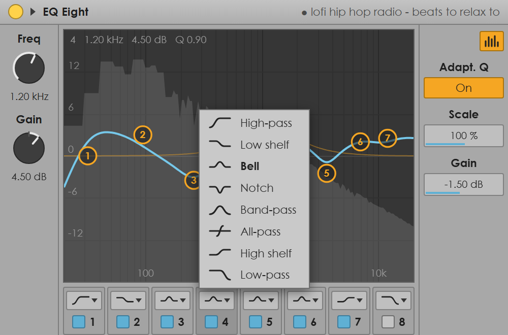
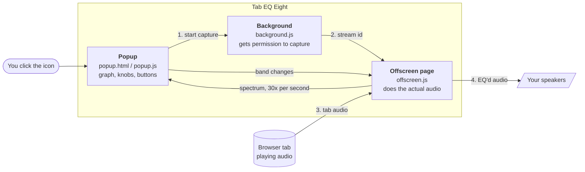
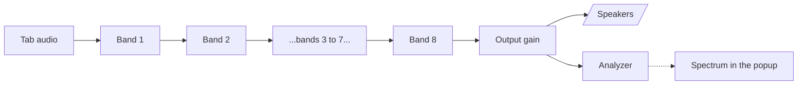

<h1 align="center">Tab EQ Eight</h1>

<p align="center">
  An 8-band parametric EQ for whatever is playing in your Chrome tab,<br>
  styled after Ableton Live's EQ Eight.
</p>

<p align="center">
  
</p>

<p align="center">
  
  
  
</p>

---

## What is this?

You know how YouTube, Spotify Web or a SoundCloud tab always sounds a little
too boomy, or too thin, and there's nothing you can do about it? This fixes that.

Tab EQ Eight grabs the audio coming out of one browser tab, runs it through
eight filters you control, and plays it back to you. You shape the sound by
dragging dots on a graph, exactly like you would in a DAW. A live spectrum
behind the curve shows you what the music is actually doing.

It is plain HTML, CSS and JavaScript. No npm, no bundler, no libraries.
Every filter is the browser's own built-in `BiquadFilterNode`.

## Features

- **8 bands**, each one can be any of 8 filter shapes
- **Drag the numbered dots** to set frequency and gain, **scroll** on a dot to change Q
- **Double-click** empty space to add a band, double-click a dot to remove it
- **Live spectrum analyzer** drawn behind the curve (after the EQ, so you see the result)
- **Adaptive Q**, **Scale** and output **Gain**, like the real EQ Eight
- The curve is computed from the same math as the audio, so **what you see is what you hear**
- Your settings are **saved automatically** and come back next time

## Install

This isn't on the Chrome Web Store, so you load it yourself. It takes 30 seconds.

1. Download or clone this repo
2. Open `chrome://extensions` in Chrome (version 116 or newer)
3. Turn on **Developer mode** (top right corner)
4. Click **Load unpacked** and pick the `EQEXT` folder
5. Pin the extension so its icon stays in your toolbar

## How to use it

1. Open a tab that plays audio and press play
2. Click the **Tab EQ Eight** icon in the toolbar. The EQ opens.
3. Click the round **yellow light** in the top left. It lights up, and the
   tab's name appears in the title bar. Audio is now going through the EQ.
4. Shape the sound. Close the popup whenever you want, the EQ keeps running.
5. Click the light again to turn it off. The tab goes back to normal.

> **Heads up:** Chrome closes extension popups when you click anywhere else,
> including the web page. That's normal. The EQ keeps working in the
> background, just click the icon again to keep tweaking.

### Controls cheat sheet

| Where | Action | What it does |
| --- | --- | --- |
| Graph | Drag a dot | Move a band: left/right is frequency, up/down is gain |
| Graph | Scroll on a dot | Make that band narrower or wider (Q) |
| Graph | Double-click empty space | Add a new bell band right there |
| Graph | Double-click a dot | Remove that band |
| Band row | Shape button | Pick one of the 8 filter shapes |
| Band row | Blue checkbox | Turn a band on or off |
| Freq / Gain knobs | Drag up or down | Adjust the selected band |
| Knobs and boxes | Hold Shift while dragging | Fine adjustment |
| Knobs and boxes | Double-click | Reset to default |
| Spectrum button | Click | Show or hide the analyzer |

### The 8 filter shapes

<p align="center">
  
</p>

| Shape | Use it to | Uses gain? |
| --- | --- | --- |
| High-pass | Cut rumble and mud below a frequency | No |
| Low shelf | Boost or cut everything below a frequency | Yes |
| Bell | Boost or cut a range around a frequency | Yes |
| Notch | Remove one narrow frequency (a hum, a whistle) | No |
| Band-pass | Keep only a range, like a telephone effect | No |
| All-pass | Shift phase without changing volume (mostly for nerds) | No |
| High shelf | Add or remove air and brightness | Yes |
| Low-pass | Cut harsh highs above a frequency | No |

Bands that don't use gain sit on the 0 dB line and only move left and right.

### The right-hand panel

- **Adapt. Q**: when on, bells get narrower the harder you boost or cut them,
  and wider as they approach 0 dB. Big moves stay surgical, gentle moves stay
  musical. At 6 dB you get exactly the Q you set.
- **Scale**: multiplies every band's gain at once. 50% halves the whole curve,
  200% doubles it, 0% flattens it. Great for "same shape, just less".
- **Gain**: overall volume after the EQ, from -12 to +12 dB. Handy when a big
  boost makes things too loud.

## How it works

Chrome extensions are split into separate pieces that can't all do everything,
so this one has three parts that talk to each other with messages.



**Why three parts?**

- The **popup** is what you see. It only exists while it's open.
- The **background** script can ask Chrome for permission to capture a tab,
  but it has no access to audio at all.
- The **offscreen page** is an invisible page that stays alive and can run
  Web Audio. This is where the sound actually gets processed, which is why
  the EQ keeps working after the popup closes.

### The audio chain

Once capture starts, the offscreen page builds this and leaves it running:



Some details worth knowing:

- Chrome **mutes a tab while it's being captured**. That's why the chain has
  to end at your speakers, otherwise you'd hear nothing.
- A band that's turned off isn't removed. It becomes a flat 0 dB filter,
  which changes nothing, so switching bands on and off never glitches.
- Parameter changes glide over about 20 ms instead of jumping, so dragging
  a dot doesn't click or pop.

### Why the curve matches what you hear

The popup doesn't guess the shape of the curve. For every band it asks a real
`BiquadFilterNode` "what is your response at these 256 frequencies?" using
`getFrequencyResponse()`, then adds all the answers together in dB.

Both the popup and the offscreen page load the same `shared.js`, which holds
the one function that turns a band's settings into filter settings. Same code,
same numbers, same curve.

The **blue line** is the total of all bands. The **faint orange line** is only
the band you have selected. Each dot sits at its own band's frequency and gain,
so if bands overlap (or a band-pass is cutting everything around it) a dot can
sit off the blue line. That's correct: the dot shows what that one band is
doing, the blue line shows what you actually hear.

## What's in the folder

```
EQEXT/
├── manifest.json     Extension config: permissions, popup, background script
├── background.js     Asks Chrome for a capture stream, starts the offscreen page
├── offscreen.html    Invisible page that hosts the audio engine
├── offscreen.js      Captures the tab, runs the 8 filters, sends spectrum frames
├── shared.js         Filter types, ranges, defaults, and the band to filter math
├── popup.html        Layout of the EQ window
├── popup.css         The Ableton mid-gray look
├── popup.js          Graph drawing, dragging, knobs, menus, saving settings
└── docs/             Screenshots used in this README
```

| File | Lines | In one sentence |
| --- | ---: | --- |
| `popup.js` | 832 | Everything you see and touch |
| `popup.css` | 295 | Colors, layout and the Live-style controls |
| `offscreen.js` | 153 | The audio engine |
| `shared.js` | 121 | The rules both sides agree on |
| `background.js` | 62 | The permission broker |

## Limitations

- **One tab at a time.** Starting the EQ on a new tab stops it on the old one.
- **Some pages can't be captured**, like `chrome://` pages and the Chrome Web Store.
- **Shelves ignore Q.** The browser's shelf filters have a fixed slope, so
  scrolling on a shelf dot does nothing.
- **Low-pass and high-pass Q means resonance.** Higher Q adds a bump right at
  the cutoff instead of making the band narrower.
- **Popups close on click-away.** That's Chrome, not a bug. The EQ stays on.

## Permissions, and why

| Permission | Why it's needed |
| --- | --- |
| `tabCapture` | To read the audio coming out of the tab |
| `activeTab` | Chrome only lets you capture the tab you clicked the icon on |
| `offscreen` | To run the audio engine on an invisible page |
| `storage` | To remember your EQ settings |
| `tabs` | To show the tab's title in the EQ window |

Nothing is sent anywhere. There's no network code in this extension at all.

## Tinkering with it

There's no build step. Edit any file, then hit the reload arrow on the
extension's card in `chrome://extensions` and reopen the popup.

To debug the audio side, open `chrome://extensions`, find Tab EQ Eight, and
click the **offscreen.html** link under "Inspect views" while capture is on.

## Credits

The look is inspired by EQ Eight from Ableton Live. This is an independent
fan project and is not made by, affiliated with, or endorsed by Ableton.

## License

MIT, see [LICENSE](LICENSE).
