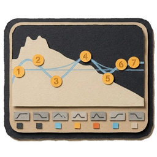
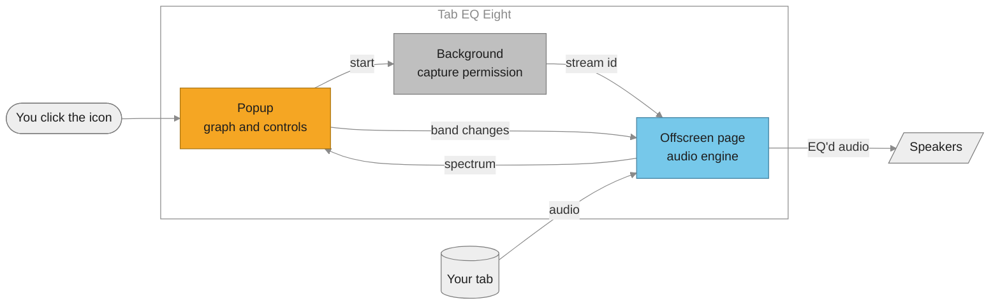
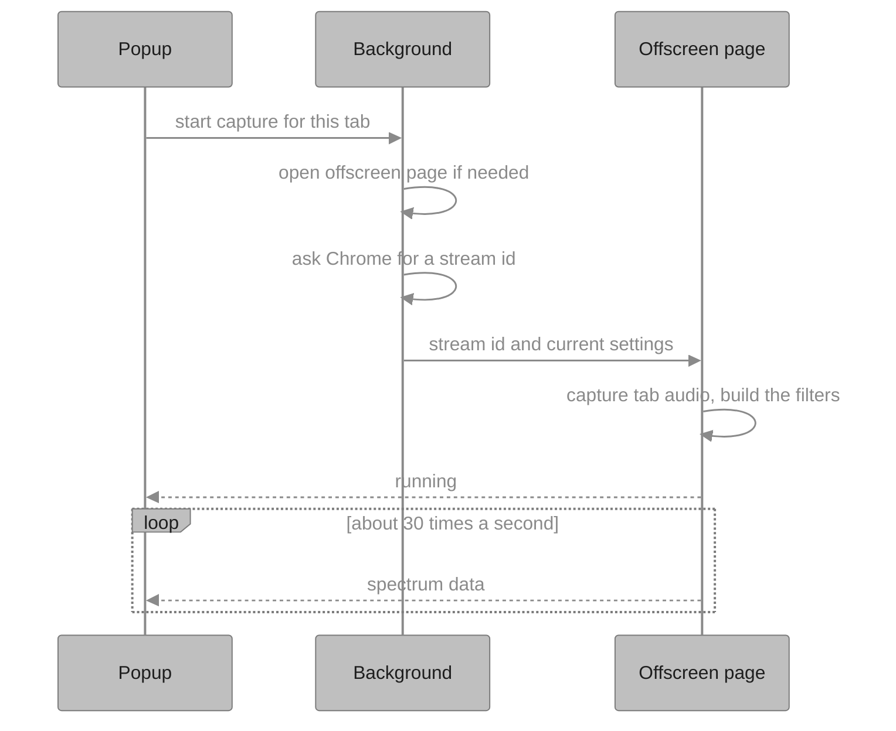
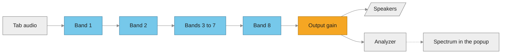

<p align="center">
  
</p>

<h1 align="center">Tab EQ Eight</h1>

<p align="center">
  An 8-band EQ for the audio in your Chrome tab, styled after Ableton Live's EQ Eight.
</p>

<p align="center">
  <a href="https://github.com/barrackmobamba69/EQEXT/archive/refs/heads/main.zip"><b>Download ZIP</b></a>
  ·
  <a href="#install">Install guide</a>
  ·
  <a href="#troubleshooting">Troubleshooting</a>
</p>

<p align="center">
  
</p>

## Why I made this

Most EQ extensions on the Chrome Web Store ask for access to every website you
visit, are full of ads, or send your data to their servers. Some extensions
have even been caught stealing passwords. I wanted an EQ that only does EQ.

Tab EQ Eight can't read or change any web page, and it has no network code,
so nothing ever leaves your computer. All the code is in this repo.

## Features

- 8 bands, each can be one of 8 filter types
- Drag the dots on the graph to shape the sound
- Live spectrum of what you're hearing
- Adaptive Q, Scale and output Gain, like the real EQ Eight
- Settings are saved automatically

## Install

It's not on the Chrome Web Store, so you install it yourself. It takes about a minute.

1. **Download it.** Click the green **Code** button at the top of this page, then
   **Download ZIP**. Or use the [Download ZIP](https://github.com/barrackmobamba69/EQEXT/archive/refs/heads/main.zip) link.
2. **Unzip it.** You'll get a folder called `EQEXT-main`. Move it somewhere you
   won't delete it, like your Documents folder. Chrome runs the extension from
   this folder, so if you delete it, the extension stops working.
3. **Open the extensions page.** Type `chrome://extensions` in the address bar and press Enter.
4. **Turn on Developer mode** with the switch in the top right corner.
5. **Click Load unpacked** and select the `EQEXT-main` folder. Pick the one that
   has `manifest.json` directly inside it. Windows sometimes unzips into a
   folder inside a folder, so you may need to go one level deeper.
6. **Pin it.** Click the puzzle piece icon in the Chrome toolbar and click the
   pin next to Tab EQ Eight.

Needs Chrome 116 or newer. Edge and Brave are built on Chrome and should work
too, but I've only tested Chrome.

## How to use it

1. Play something in a tab
2. Click the Tab EQ Eight icon. The EQ opens.
3. Click the round light in the top left corner. It turns yellow and the tab's
   name shows up. You're now hearing the EQ.
4. Drag the numbered dots to shape the sound
5. Click the light again to turn the EQ off

The window closes when you click outside it, that's just how Chrome works.
The EQ keeps running. Click the icon again to get back to it.

### Controls

| Where | Do this | What happens |
| --- | --- | --- |
| Graph | Drag a dot | Left and right changes frequency, up and down changes gain |
| Graph | Scroll on a dot | Makes that band narrower or wider |
| Graph | Double-click empty space | Adds a band there |
| Graph | Double-click a dot | Removes that band |
| Below the graph | Click a filter button | Changes the filter type |
| Below the graph | Click a blue checkbox | Turns a band on or off |
| Freq and Gain knobs | Drag up or down | Adjusts the selected band |
| Any knob or box | Hold Shift while dragging | Fine adjustment |
| Any knob or box | Double-click | Resets it |

### Filter types

<p align="center">
  
</p>

| Type | What it's for |
| --- | --- |
| High-pass | Cuts everything below a frequency, removes rumble and mud |
| Low shelf | Turns up or down everything below a frequency |
| Bell | Turns up or down a range around a frequency |
| Notch | Removes one narrow frequency, like a hum |
| Band-pass | Keeps only a range, like a phone speaker |
| All-pass | Shifts phase without changing volume |
| High shelf | Turns up or down everything above a frequency |
| Low-pass | Cuts everything above a frequency, removes harshness |

High-pass, Notch, Band-pass, All-pass and Low-pass have no gain, so their dots
stay on the middle line and only move left and right.

### Right side panel

- **Adapt. Q:** bands get narrower the more you boost or cut them
- **Scale:** turns every band up or down at once. 50% halves the whole curve, 0% makes it flat
- **Gain:** overall volume after the EQ, from -12 to +12 dB

## Updating

Download the new ZIP and replace the files inside your existing `EQEXT-main`
folder. Then open `chrome://extensions` and click the reload arrow on Tab EQ Eight.
Your settings stay as long as the folder stays in the same place.

## Uninstalling

Open `chrome://extensions`, click **Remove** on Tab EQ Eight, then delete the folder.

## Troubleshooting

**"Manifest file is missing or unreadable"**
You picked the wrong folder. Pick the one with `manifest.json` directly inside it.

**The light won't turn on, or it says capture failed**
Open the tab you want to EQ, then click the extension icon from that tab and
press the light. Chrome only lets an extension capture the tab you clicked its icon on.

**It doesn't work on some pages**
Chrome blocks capture on its own pages like `chrome://` pages and the Chrome Web Store.

**The EQ stopped on my other tab**
It works on one tab at a time. Turning it on in a new tab turns it off in the old one.

**It's too loud after boosting**
Lower the Gain box on the right side.

## How it works

This part is for developers.

Chrome extensions are split into parts that can each do different things,
so this one has three parts that send messages to each other:

- **Popup** (`src/popup`): the window you see. It only exists while it's open.
- **Background** (`src/background.js`): gets Chrome's permission to capture the tab.
- **Offscreen page** (`src/offscreen`): an invisible page that stays open and
  processes the audio. That's why the EQ keeps working when the popup closes.



What happens when you press the light:



Inside the offscreen page, the audio goes through all 8 filters in a row:



A few details:

- Chrome mutes a tab while it's being captured, so the audio has to be sent
  back out to the speakers or you'd hear nothing.
- Every filter is the browser's built-in `BiquadFilterNode`. There are no
  libraries and no build step.
- A band that's turned off becomes a flat filter instead of being removed, so
  switching bands on and off doesn't glitch.
- The popup draws the curve by asking real filters for their response, using
  the same code as the audio (`src/shared.js`), so the curve matches what you hear.
- The blue line is the total of all bands. The faint orange line is the
  selected band on its own.

### Project layout

```
EQEXT/
├── manifest.json          Extension settings and permissions
├── icons/                 Toolbar and extensions page icons
├── src/
│   ├── background.js      Gets capture permission, opens the offscreen page
│   ├── shared.js          Filter types, ranges, and the filter math
│   ├── popup/             The EQ window (HTML, CSS, JS)
│   └── offscreen/         The audio engine
└── docs/                  Images for this README
```

### Permissions

| Permission | Why |
| --- | --- |
| `tabCapture` | Read the audio coming out of the tab |
| `activeTab` | Chrome only allows capturing the tab you clicked the icon on |
| `offscreen` | Run the audio engine on an invisible page |
| `storage` | Save your settings |

### Making changes

There's nothing to build. Edit a file, click the reload arrow on Tab EQ Eight
in `chrome://extensions`, and open the popup again. To debug the audio, click
**offscreen.html** under "Inspect views" on the extension's card while the EQ is on.

## License

MIT, see [LICENSE](LICENSE).

Not affiliated with or endorsed by Ableton.
